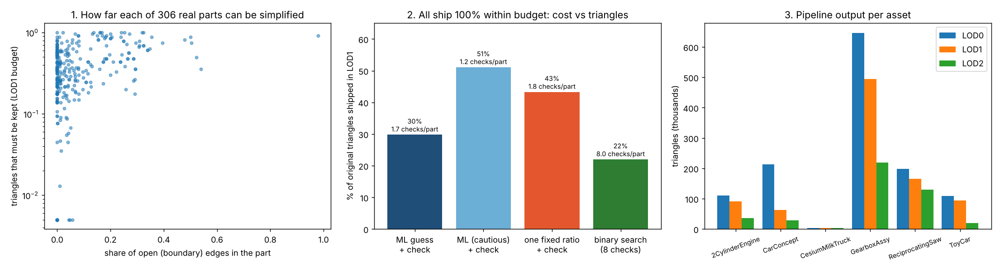

# XR 3D Automation Pipeline: Raw CAD and Artist Meshes In, XR-Ready LODs Out

[](https://github.com/f20220970-debug/xr-3d-automation-pipeline/actions/workflows/tests.yml)

**[Live demo](https://f20220970-debug.github.io/xr-3d-automation-pipeline/)**: Rotate a car at three levels of detail.

## In 30 seconds
- A batch pipeline cleans real CAD and artist models, fixes units and builds verified LODs for Unity.
- An ML model needs 4.8x fewer checks than step-by-step search on unseen models, and gives 31% lighter files than a fixed ratio.
- A full 115-part engine runs 3.5x faster.


Built exclusively for **Metadome.ai's PS-II project "3D Automation Pipeline and XR"**: Python tools that
process complex 3D data automatically (cleanup, units, optimisation), an **ML model that removes a pipeline
bottleneck** standard scripting can't, and outputs structured to drop into Unity or Unreal without manual fixes.

> **Real assets.** 28 public 3D models from the Khronos glTF sample collection, including a concept car,
> a buggy, a truck, a 2-cylinder engine, a gearbox and a power saw exported from CAD, plus artist-made models.
> `python scripts/get_data.py` downloads them (~210 MB, not stored in the repo).



## What the pipeline does (`xrpipe/pipeline.py`)
```
raw GLB/glTF/OBJ ─► clean ─► fix units + pivot ─► LOD0/1/2 per part ─► verify error ─► export *_LOD0/1/2.glb ─► QA report
                    weld duplicates     guess mm/cm/m/in        ML predicts how far    step up if over    Unity builds a      triangles vs XR budget,
                    drop bad faces      from expected size;     each part can be       budget: never      LODGroup from the   flags for a human
                    fix normals         flag if unsure          simplified             ship over budget   suffix
```
```bash
python -m xrpipe.pipeline data/CarConcept.glb --expected-size 3 6 --out out/    # one asset
python -m xrpipe.pipeline data/ --out out/                                       # a whole folder
```

### Results on 6 assets (`scripts/run_pipeline_demo.py`)
| Asset | Parts | Detected unit | Size (m) | Triangles LOD0 → LOD1 → LOD2 | Cleanup found | XR budget |
| --- | --- | --- | --- | --- | --- | --- |
| Concept car | 109 | m | 2.5 × 1.1 × 4.4 | 213K → 62K → 29K | 48K duplicate vertices, 2 non-manifold parts | pass |
| 2-cylinder engine (CAD) | 115 | **mm → rescaled** | 0.74 × 0.27 × 0.27 | 110K → 91K → 36K | **11,160 duplicate faces** removed | pass |
| Gearbox (CAD) | 95 | cm, **flagged: unsure** | 0.30 × 0.11 × 0.19 | 646K → 495K → 219K | 38K duplicate vertices | **fail: flagged** |
| Power saw (CAD) | 113 | mm → rescaled | 0.37 × 0.08 × 0.15 | 198K → 166K → 129K | 55K duplicate vertices | LOD1/2 fail: flagged |
| Toy car | 3 | m | 0.07 × 0.03 × 0.07 | 109K → 94K → 20K | 5K duplicate vertices | pass |
| Milk truck | 5 | m | 2.8 × 2.6 × 4.9 | 3.6K (already light) | none | pass |

Every LOD of every part is **checked** against its error budget (p95 surface deviation: 0.2% of the part's
size for LOD1, 1% for LOD2) and the ratio is stepped up if it fails, so nothing ships over budget. The gearbox
and saw are reported, not silently passed: their CAD parts are dense, sharp-edged and can't be simplified
much within budget, which needs a decision (looser budget, normal-map baking, or merging small parts).

## The ML part: predicting how far each part can be simplified (`scripts/train_keep_model.py`)
**The bottleneck.** Finding the lightest LOD that stays within an error budget means a binary search: about
8 rounds of decimation plus error checks per part, per LOD. A car with hundreds of parts makes this the
slowest step.

**The model.** For each of **306 real parts** (28 assets) I computed the true answer by binary search, plus
14 cheap shape features (curvature, sharp-edge share, open-edge share, edge-length spread, aspect ratio...).
A gradient-boosted model predicts the keep ratio from the features; the pipeline decimates once, checks, and
steps up only if needed.

**Evaluation on unseen assets** (5-fold, grouped by asset, so a car's parts never appear in its own test):

| Method (LOD1, everything ships within budget) | Triangles shipped (% of original) | Checks per part |
| --- | --- | --- |
| Binary search (the slow, exact answer) | 22.0% | 8.0 |
| **ML guess + check** | **29.8%** | **1.7** |
| One fixed ratio for all parts + check | 43.3% | 1.8 |
| Cautious ML (90% quantile) + check | 51.1% | 1.2 |

- **4.8× fewer checks than binary search**, at 7.8 points more triangles.
- **31% fewer triangles than a fixed ratio** for about the same cost. Same pattern at LOD2 (14.4% vs 17.9%,
  1.96 checks vs 8).
- On the full engine asset the pipeline ran in **52 s with the model vs 179 s with binary search (3.5×)**,
  shipping 91K vs 80K LOD1 triangles. Speed vs triangles is a setting, not a hidden choice.
- What drives it: mean curvature (dihedral angle) and the share of sharp edges matter most. Parts with
  many open edges (CAD seams) can be simplified less (Spearman 0.33), so welding seams first pays off.
- Honest limits: the model alone meets the budget only about half the time (it predicts the median), which
  is why the check-and-step-up loop is part of the design, not an afterthought.

## Mistakes I caught (and the tests that guard them)
1. **Error measure with a noise floor.** My first error metric compared sample points to sample points, and
   reported 0.8% deviation for two *identical* meshes, which would have blocked every LOD. Switched to
   point-to-surface distance; `test_error_is_zero_for_identical_and_grows_with_decimation` guards it.
2. **Ignored node transforms.** The first export used raw geometry and mis-scaled the toy car (its node
   carries a 0.001 scale). Now every placed instance is baked with its transform before unit detection.

## Unity and Blender (`integrations/`)
- `unity/XrLodImporter.cs`: editor postprocessor that sets LOD screen-size thresholds, marks static batching
  and warns when LOD0 is over the triangle budget (Unity creates the LODGroup from the `_LODn` names).
- `blender/xr_cleanup_lod.py`: the same cleanup + Decimate-modifier LODs as a headless batch script
  (`blender -b -P ... -- in out`), taking per-part ratios from the model.
- These two are written against current Unity/Blender APIs but **not run in CI** (no Unity or Blender there);
  the Python pipeline is what's tested.

## Run it
```bash
pip install -r requirements.txt
python scripts/get_data.py               # 28 public assets
python scripts/build_dataset.py          # ~25 min on 2 cores: true keep ratios for 306 parts
python scripts/train_keep_model.py       # evaluation table + results/keep_model.joblib
python scripts/run_pipeline_demo.py      # 6 assets end to end + timing
python scripts/plot.py
pytest -q                                # 5 tests (no data needed): cleanup, error metric, budget, units, end to end
```

## Next steps
- Texture side of XR readiness: texture size and count limits, atlas packing, KTX2/Basis compression.
- Normal-map baking from LOD0 onto LOD2 for dense CAD parts (the gearbox case).
- Merge small parts that share a material to cut draw calls, which often matters more than triangles on
  standalone headsets.
- A learned unit/orientation classifier once there are labelled client assets.

Built by Pavitra Seth (BITS Pilani, B.E. Mechanical + M.Sc. Chemistry) as preparation for Metadome.ai's
PS-II. Not affiliated with Metadome.ai.
